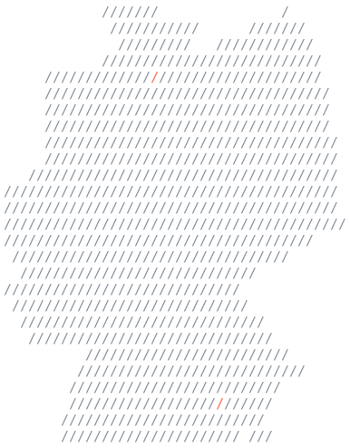

# Lucas Reimers

I study engineering science (B.Sc.) at TUM. I'm interested in data, agent tooling and simulation.

Some stuff I've built:

- [Halliday 2D](https://github.com/lucas19919/Halliday2D): 2D physics engine in C++
- [diagonaldiagrams](https://github.com/lucas19919/diagonaldiagrams): diagrams for AI agents, on PyPI
- [Parzi](https://github.com/lucas19919/Parzi): coding harness built in Rust
- [Strohmann](https://strohmann.xyz): political and economic knowledge graph for the EU
- Sepia: an ontology compiler and data platform in Rust
